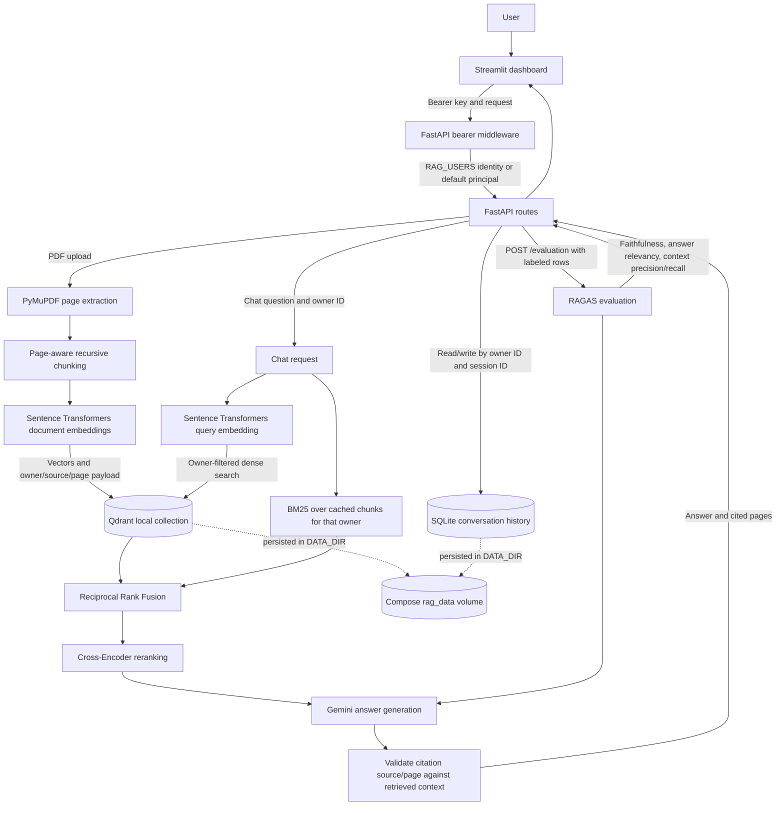

# Architecture

This diagram reflects the current FastAPI/Streamlit application. Local Qdrant and SQLite both persist under the Compose `rag_data` volume. Only `GET /health` bypasses bearer authentication; when `RAG_USERS` is configured, the authenticated key maps to the owner ID used for document and conversation scoping.

## Retrieval details

- **Semantic stage:** the query embedding searches Qdrant with an owner filter.
- **Hybrid stage:** BM25 ranks the same owner's cached chunk payloads. Reciprocal Rank Fusion combines dense and sparse candidate ranks.
- **Reranked stage:** a Cross-Encoder scores the fused candidates; normal chat uses the reranked results.
- **Citations:** Gemini is prompted to cite source and page labels. The application rejects missing, malformed, or unrecognized references and returns only labels present in the retrieved contexts. This checks reference identity, not whether a cited passage entails each claim.

The benchmark CLI can measure the three retrieval stages against supplied relevance labels. It must use the same Qdrant store and owner IDs as the indexed corpus; local Qdrant cannot be opened by the benchmark and API processes at the same time.
